<p align="center">
  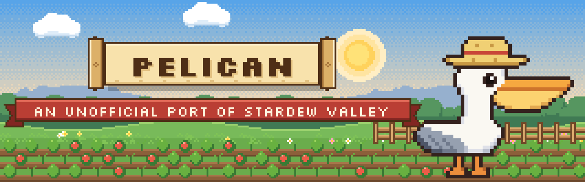
</p>

<p align="center">
  <b>An unofficial port of Stardew Valley 1.6.15 to the Nintendo 3DS family.</b><br>
  Make a farmer, work the land, and join your friends' PC, iOS and Android farms over local Wi-Fi.
</p>

<p align="center">
  <a href="#download">Download</a> ·
  <a href="#gameplay">Gameplay</a> ·
  <a href="#working-now">Features</a> ·
  <a href="#controls">Controls</a> ·
  <a href="#getting-started">Setup</a> ·
  <a href="#updating">Update</a> ·
  <a href="#logs-and-bug-reports">Report a bug</a>
</p>

> [!IMPORTANT]
> **Early alpha.** Pelican is a work in progress, and there's no saving yet. You
> need your own purchased **PC copy of Stardew Valley 1.6.15**. Pelican doesn't
> include any game files. You convert your own copy, and it stays on your SD card.

<a id="about"></a>
<h2 align="center"></h2>

Pelican is a native 3DS engine that reads Stardew Valley's own content after you
convert it from your PC copy. It isn't an emulator or a stream. The game logic
follows PC version 1.6.15, and every difference from PC is recorded with its
reason.

- **Every 3DS model is supported.** The original 3DS / 3DS XL / 2DS are the
  baseline, and New 3DS / New 3DS XL / New 2DS XL get extra speed where they can.
- **It's designed for two screens.** The world is on top, and the HUD, hotbar
  and menus are on the touch screen.
- **Co-op with other platforms works today.** A 3DS can join a farm hosted on
  PC, iPhone/iPad or Android on the same network as a farmhand. Both sides see
  each other's tools, trees, rocks and drops change.

This release is mainly for collecting **networking and performance results on
real hardware**. Smooth sessions are as useful to report as problems.

<a id="download"></a>
<h2 align="center"></h2>

Get the files from the **[Releases](../../releases)** page:

| File | What it's for |
| --- | --- |
| `pelican.cia` | Installs Pelican on the HOME Menu with its own icon and banner (FBI, see below). |
| `pelican.3dsx` | Runs from the Homebrew Launcher instead. Put it in `sd:/3ds/Pelican/`. |
| `pelican-convert-windows.zip` | The PC converter for Windows. Unzip it: the `pelican-convert` folder holds `pelican-convert.exe` and the `libwinpthread-1.dll` it needs. |

You need a 3DS with custom firmware (Luma3DS). If you don't have it yet, follow
[3ds.hacks.guide](https://3ds.hacks.guide/).

### Install with FBI (scan the QR code)

<table>
<tr>
<td width="200" align="center">
<!-- QR CODE: GitHub's permanent link to the newest release's pelican.cia, so it never needs changing. -->

</td>
<td>

1. On the 3DS, open **FBI**.
2. Choose **Remote Install > Scan QR Code**.
3. Point the camera at the QR code on the left and confirm the install.
4. Pelican appears on your HOME Menu.

<sub>The QR code always links to the newest <code>pelican.cia</code>.</sub>

</td>
</tr>
</table>

<a id="updating"></a>
### Updating

Your converted game files stay on the SD card (`3ds/Pelican/`), so updating
never means converting again unless the title menu asks for it. Pick any of
these:

| Way | How |
| --- | --- |
| **In Pelican** (easiest) | Pelican checks for a new release each time it starts while the 3DS is online. When there is one, the title menu offers it: choose **OK**. It downloads and installs it, then closes. Start it again and the corner of the title menu shows the new version. This works for both the HOME Menu install (`.cia`) and the Homebrew Launcher copy (`.3dsx`). |
| **FBI, scan the QR code** | Do the same as the first install (above). The QR code always links to the newest `pelican.cia`, and FBI installs it over the old one. |
| **FBI, from the SD card** | Download `pelican.cia` from [Releases](../../releases), copy it anywhere on the SD card, then in FBI choose **SD**, find the file, and pick **Install CIA**. |
| **Homebrew Launcher** | Download `pelican.3dsx` from [Releases](../../releases) and replace the old one in `sd:/3ds/Pelican/`. |

If a new version needs some game files converted again, the title menu offers
to open the converter.

> [!NOTE]
> **Coming from 0.0.1 with the HOME Menu install?** Pelican 0.0.2 has a new
> title ID (0.0.1's clashed with another homebrew app), so it installs as a
> **second** Pelican instead of replacing the old one. After 0.0.2 is
> installed, delete the old one: **System Settings > Data Management >
> Nintendo 3DS > Software**, pick the older *Pelican*, then **Delete** (or use
> FBI > **Titles**). Nothing you need is lost, because your converted files and
> logs are on the SD card, not in the title. The `.3dsx` isn't affected.

<a id="gameplay"></a>
<h2 align="center"></h2>

<!-- SCREENSHOTS: every picture below is in images/shots/. Replace a "coming soon" slot by saving a
     real screenshot under the same name, 400 x 480 (Rosalina menu: L + Down + Select > Take
     screenshot; Luma saves the top and bottom screens as separate BMPs in /luma/screenshots,
     stacked into one PNG with tools/release_art). -->

<table>
<tr>
<td align="center">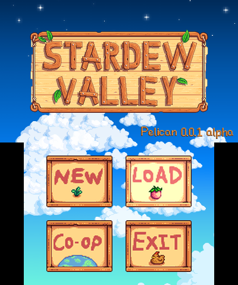<br><sub>The title screen and its menu on the touch screen</sub></td>
<td align="center">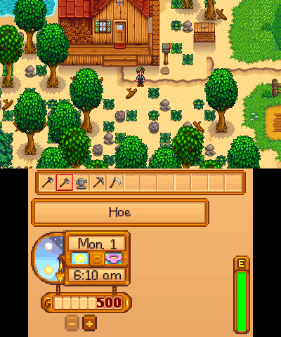<br><sub>Your farm, with the HUD on the bottom screen</sub></td>
</tr>
<tr>
<td align="center">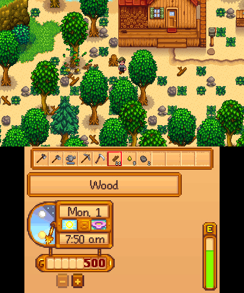<br><sub>Chopping, mining, hoeing and watering</sub></td>
<td align="center">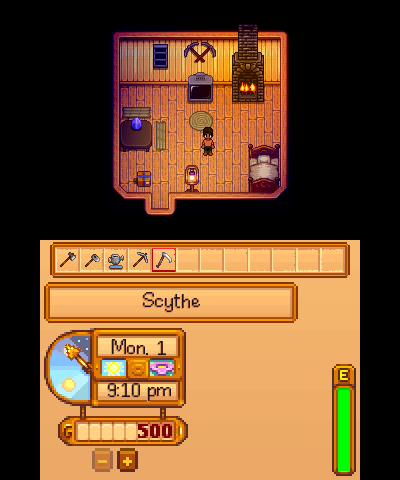<br><sub>Night falls, and the lamps and fireplace light up</sub></td>
</tr>
<tr>
<td align="center">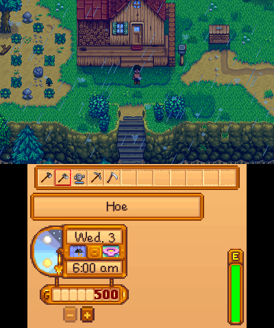<br><sub>Weather, with rain at every zoom level</sub></td>
<td align="center">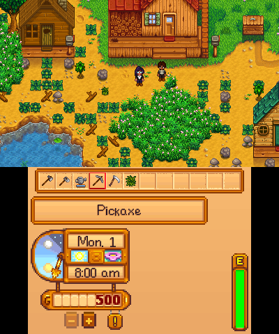<br><sub>A 3DS farmhand on a PC host's farm</sub></td>
</tr>
<tr>
<td align="center">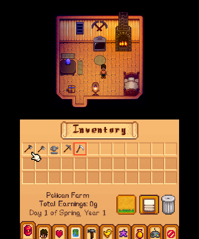<br><sub>The Start menu's inventory page</sub></td>
<td align="center">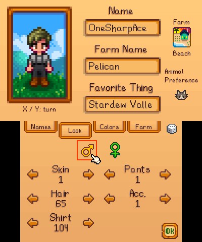<br><sub>Character creation over both screens</sub></td>
</tr>
</table>

<a id="working-now"></a>
<h2 align="center"></h2>

**Starting a game**
- ✅ Title screen with its music, sounds and hidden surprises
- ✅ Character creation: your look, farm types, pets and Advanced options
- ✅ The opening: grandpa's story, the office and the bus ride (Start skips them)

**On the farm** (single player and co-op)
- ✅ The farm and the farmhouse with its furniture and the starter gift
- ✅ Day and night, with lit windows, lamps and a working fireplace
- ✅ Sleeping, passing out at 2 AM, and a new day. The farm changes overnight, and rain and other weather arrive.
- ✅ Hoe, watering can (refill it at water), axe, pickaxe, scythe and weapons
- ✅ Trees (felled, stumps, saplings), stones, boulders, logs, bushes, weeds and grass
- ✅ Drops fly to you and go into your inventory
- ✅ Hold **Y** to keep swinging, like holding the button on PC
- ✅ Bottom-screen HUD: hotbar, held item details, clock, date, money, energy and zoom
- ✅ Start menu with the Inventory page: move, stack, organize, trash and drop items
- 🆕 **Crops**: plant seeds and fertilizer on tilled soil, water them, and watch them grow overnight. Crops die out of season, and crows can eat them. Harvest by hand (the crop is lifted over your head) or with the scythe, with PC's quality and experience.
- 🆕 **Shipping bin**: hold an item and press **Y** at the bin to throw the stack in. You're paid overnight at PC's prices.
- 🆕 Held items show over your farmer's head, for every player

**Co-op** (3DS as a farmhand)
- ✅ Finds farms on your network by name, or joins by IP address
- ✅ PC, iPhone/iPad and Android hosts
- ✅ New farmhands (with character creation) or existing ones
- ✅ Other players' movement, looks, tools and effects, and your changes on their screens
- ✅ Going to bed together: the ready check, the new day with the host, and sleeping in your own cabin

**Converting**
- ✅ PC converter, browser converter over Wi-Fi, or converting on the console

<a id="planned"></a>
<h2 align="center"></h2>

In roughly this order:

1. 📦 **Shipping bin screens**: the bin's item menu and the end-of-night earnings screen
2. 💾 **Saving and loading**, including PC saves
3. 🏠 **Interiors**: other buildings, their lights and night tiles

After that:
- 🧑‍🌾 Villagers, dialogue, events and shops
- 🐔 Animals and pets
- 🎣 Fishing, then the mines and combat
- 📜 The other Start menu pages: skills, social, map, crafting, collections and options
- 🍂 Seasonal map art (maps still show spring)
- 🌐 Hosting a farm from a 3DS, plus Steam/GOG invite codes
- 🧩 Long term: mod support (Content Patcher and friends)

<a id="controls"></a>
<h2 align="center"></h2>

<p align="center">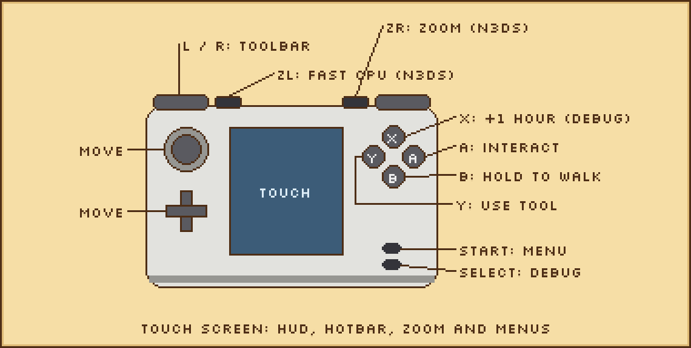</p>

| Button | In the game |
| --- | --- |
| Circle Pad / D-pad | Move (you run by default) |
| **B** (hold) | Walk |
| **A** | Interact: doors, beds, the gift box, the fireplace. Harvest a ripe crop, or plant the held seeds. |
| **Y** | Use the held tool. Hold it to keep swinging, or to charge an upgraded tool. Holding seeds: plant them. At the shipping bin: throw the held item in. A ripe crop in front of you is picked first. |
| **L / R** | Previous / next item in the toolbar |
| **Start** | Open the menu (tabs on the touch screen) |
| **ZR** *(New 3DS)* | Cycle the zoom 1x / 2x / 3x (on any model you can also tap the zoom button on the HUD) |
| **Touch screen** | Hotbar, item details (tap the item's name), zoom, menus |
| Select | Debug overlay: frame rate and the held item (for testing) |
| X | +1 hour (single player, for testing) |
| ZL *(New 3DS)* | Toggle the fast CPU mode (for testing) |

In menus, the D-pad or Circle Pad moves and **A** chooses, or you can tap. **B** goes back.

<a id="getting-started"></a>
<h2 align="center"></h2>

Pelican needs the art, sounds and data from **your own PC copy of Stardew
Valley 1.6.15**. You need it even if your co-op host is on iOS or Android. You
convert that copy once, and there are three ways to do it:

| Method | Speed | How it reaches the 3DS |
| --- | --- | --- |
| **[PC converter](#pc-converter)** (`pelican-convert.exe`) | ⭐ Fastest and most tested | Copy one ZIP (or a folder) to the SD card |
| **[Browser converter](#browser-converter)** | Fast | Sent straight to the 3DS over Wi-Fi |
| **[On the console](#on-console-converter)** | Slow (2+ hours) | Copy the game's `Content` folder to the SD card |

English is about **610 MB** on the SD card. Leave room for the ZIP while it installs.

<a id="pc-converter"></a>
<h2 align="center"></h2>

**1. Open PowerShell in the converter's folder.** Unzip `pelican-convert-windows.zip`
(right-click > Extract All), open the `pelican-convert` folder it makes, type
`powershell` in File Explorer's address bar and press Enter.

<p align="center">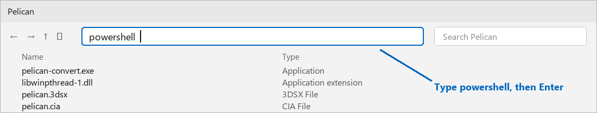</p>

**2. Convert.** Run:

```powershell
.\pelican-convert.exe convert-all --out ".\converted" --zip ".\Pelican-3DS.zip"
```

It finds Steam, GOG and Xbox app installs by itself. English and audio are
included by default. When it finishes, check that it says `failures (0): none`
and look for the `package:` line.

<p align="center">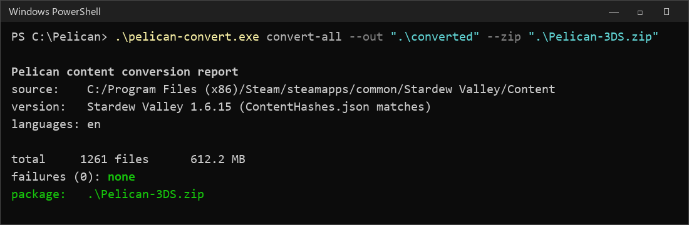</p>

If your game isn't found, tell it where the `Content` folder is. In Steam,
right-click Stardew Valley and choose **Manage > Browse local files**. A ZIP of
the Content folder works too.

<p align="center">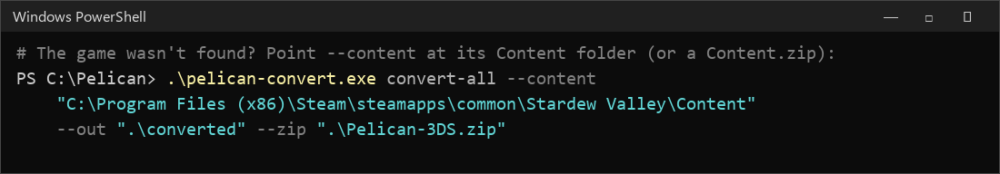</p>

**3. Copy it to the SD card.** Turn the 3DS off, take out the SD card, and put
`Pelican-3DS.zip` (keep the name) in `3ds/Pelican/`. If you use the `.3dsx`,
put `pelican.3dsx` there too.

<p align="center">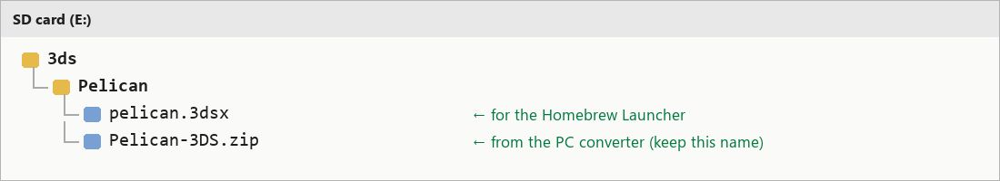</p>

**4. Install.** Start Pelican. On the **Converted on a PC** screen, choose
**Install**, then **Start game**. You can delete the ZIP afterwards.

<details>
<summary><b>Copy the folder instead of the ZIP, and other options</b></summary>

Leave out `--zip` and copy the whole `converted` folder to `3ds/Pelican/converted`.
The file `index.pidx` must be directly inside it:

<p align="center">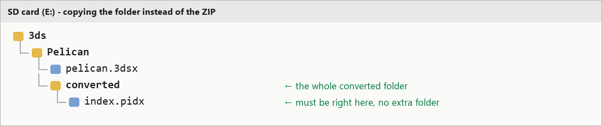</p>

| Option | What it does |
| --- | --- |
| `--languages de-DE,fr-FR` | Adds languages (English is always included). Codes: `de-DE es-ES fr-FR hu-HU it-IT ja-JP ko-KR pt-BR ru-RU tr-TR zh-CN` |
| `--threads 4` | How many CPU threads to use (default: all of them) |
| `--no-audio` | Skips music and sounds (not recommended) |
| `--fresh` | Throws away the last conversion and starts over |

- **If it was interrupted**, run the same command again. Finished work is reused.
- **If you have the wrong version**, update to PC 1.6.15. (`--allow-other-version` exists, but other versions aren't supported.)
- **If there are failures**, see `converted\convert-report.txt`. Use a clean, unmodded Content folder.

</details>

<a id="browser-converter"></a>
<h2 align="center"></h2>

The browser converter runs in your computer's browser and sends the result to
the 3DS over your home Wi-Fi. It needs no install, and there's no website to
visit, because the 3DS serves the page itself.

**1. Open the converter on the 3DS.** It opens by itself the first time, and
you can hold **Select** while Pelican starts to open it later. Connect to Wi-Fi
if asked, and pick your languages on the touch screen.

<p align="center">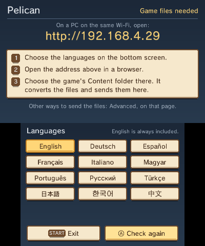</p>

**2. Open the address it shows** (like `http://192.168.1.23`, including any
`:port`) in Chrome or Edge on a computer on the same network.

**3. Choose your game's `Content` folder** under **Convert in this browser**,
and approve the browser's folder prompt. On devices that can't pick a folder,
choose a `Content.zip` instead.

<p align="center">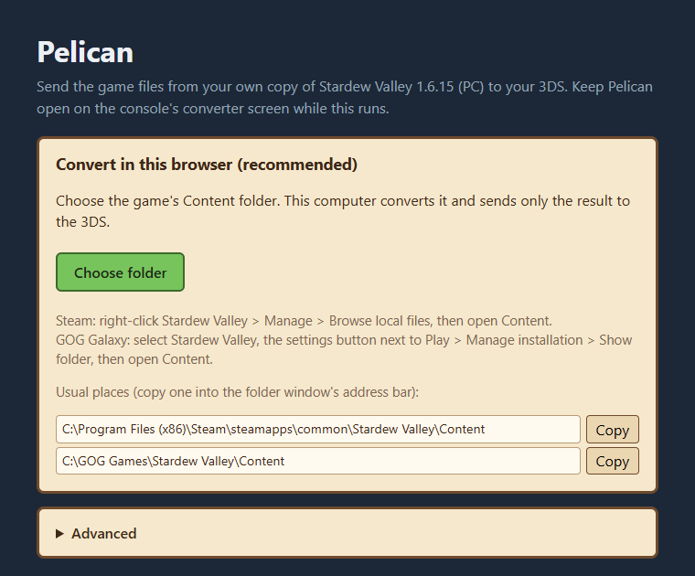</p>

**4. Wait.** At first the 3DS may say **"Waiting for the browser..."** while
the browser prepares. That's normal, so don't refresh. Keep the tab open, the
computer awake and the 3DS plugged in. When the browser says it's done and the
3DS shows **All done**, choose **Start game**.

<details>
<summary><b>Advanced: send a PC package, or let the 3DS convert</b></summary>

<p align="center">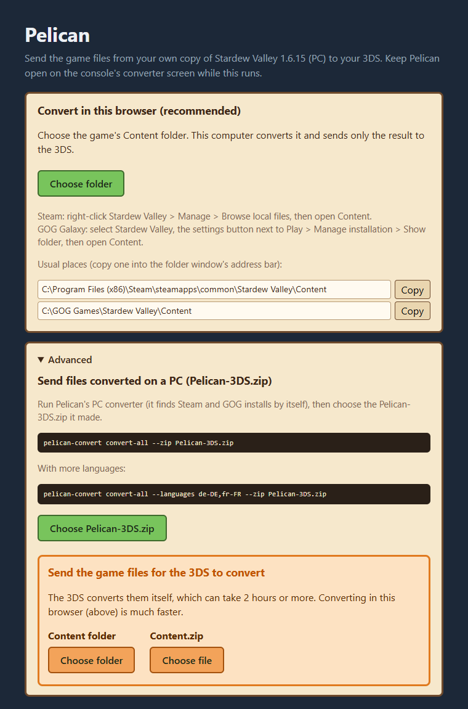</p>

- **Send files converted on a PC:** upload the `Pelican-3DS.zip` from the PC
  converter, then choose **Install** on the 3DS.
- **Send the game files for the 3DS to convert:** this uploads the Content
  folder or ZIP and converts on the console, which is much slower.
- **If it gets stuck or the tab was closed**, open the address again and pick
  the same folder. Finished work on the SD card is reused.

</details>

<a id="on-console-converter"></a>
<h2 align="center">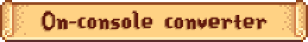</h2>

With no computer help, copy the game's `Content` folder (or `Content.zip`) into
`3ds/Pelican/` on the SD card, then start Pelican and choose **Convert**. This
takes **two hours or more**, so keep the 3DS charging with the lid open.

<a id="coop"></a>
<h2 align="center"></h2>

<p align="center">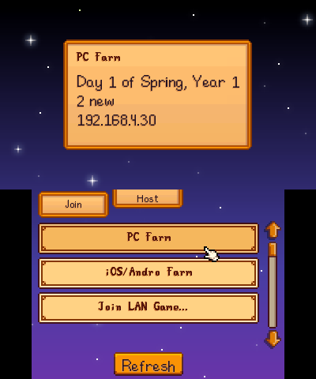 Join listing farms on the network" width="300"></p>

1. On the PC, phone or tablet, **open a co-op farm** (Co-op > Host, or load a
   farm with cabins). Keep the game in the foreground.
2. On the 3DS, choose **Co-op > Join**. Farms on your network are listed by name.
   If yours isn't listed, use **Join LAN Game...** and type the host's IP address.
3. Pick a **new farmhand** (you'll make your farmer first) or an existing one.

Tips:
- **Back up the host's save** before trying an alpha build.
- The 3DS uses 2.4 GHz Wi-Fi only. An **iPhone/iPad on Wi-Fi 6E** can miss the
  3DS's search, so turn Wi-Fi 6E Mode off for that network on the iPhone (Settings >
  Wi-Fi > ⓘ), or join by IP address.
- Steam/GOG invite codes aren't supported yet. Use your local network.

<a id="what-to-test"></a>
<h2 align="center"></h2>

- **Networking:** finding the farm, joining, staying connected, changing
  locations, and going to bed together.
- **Performance:** stutters, long pauses or input delay. Say where you were and what was happening.
- **Your setup:** the **exact console model** (original or New), the host
  platform, device and game version, your network, the number of players and
  how long you played.

<a id="logs-and-bug-reports"></a>
<h2 align="center"></h2>

Pelican writes its logs to **`3ds/pelican/`** on the SD card. **Copy them soon
after a problem**, because each launch replaces the older log.

<p align="center">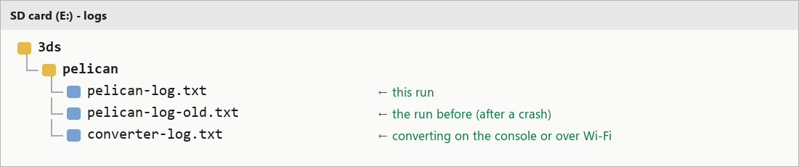</p>

1. Turn the 3DS off, put the SD card in your PC and copy the `.txt` files. If
   you restarted after a crash, copy both game logs.
2. Open **[Issues](../../issues)** and choose **New issue**. Put your model in
   the title, for example *"Old 3DS XL: disconnect entering Town"*.
3. Drag the log files into the issue and fill in the template below.

```text
Pelican build:
Console model (original/New):
Host (PC/iOS/Android), device, game version, mods:
New or existing farmhand:
Network (host on Ethernet/Wi-Fi, players):
What I did and for how long:
What happened / what I expected:
How often:
Logs attached:
```

Successful sessions with logs are welcome too. For conversion problems, also
attach `converter-log.txt` or `converted/convert-report.txt`.
[More detail on logs](Logs-and-Bug-Reports.md).

<a id="questions"></a>
<h2 align="center"></h2>

<details><summary><b>Does it include the game?</b></summary>

No. Pelican has no game art, music, text or data. You convert your own PC copy,
and the result stays on your SD card.
</details>

<details><summary><b>I play on Switch / mobile / Xbox. Can I use that copy?</b></summary>

The conversion needs the **PC version 1.6.15** files (Steam, GOG or Xbox app on
Windows). After converting, you can join hosts on PC, iOS or Android.
</details>

<details><summary><b>Can I keep my progress?</b></summary>

Not yet in single player. Saving is coming next. In co-op, the host saves the
farm as usual, including your farmhand.
</details>

<details><summary><b>Does it run on an original 3DS?</b></summary>

Yes. The original models are the baseline it's built for. New models get extra
speed. Please report how it runs on yours.
</details>

<details><summary><b>Does it work with mods?</b></summary>

Not yet. Convert an unmodded Content folder. Mod support is a long-term goal.
</details>

<a id="title-id"></a>
<details><summary><b>For homebrew developers: Pelican's title ID</b></summary>

So other apps don't clash with it, the HOME Menu install uses:

| | |
| --- | --- |
| Title ID | `000400000F6C2100` |
| Unique ID | `0xF6C21` |
| Product code | `CTR-P-PLCN` |

These are used from 0.0.2 alpha on. 0.0.1 alpha used unique ID `0xF7A3C`
(title ID `000400000F7A3C00`), which another homebrew app already used, so
please don't count on that one.
</details>

<a id="credits"></a>
<h2 align="center"></h2>

Pelican is an unofficial fan project. It is **not affiliated with or endorsed
by ConcernedApe or Nintendo**. Stardew Valley is © ConcernedApe LLC. Please buy
the game, because Pelican only works with your own copy.

<p align="center">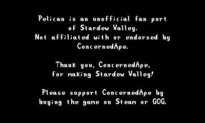<br>
<sub>Pelican says this every time it starts.</sub></p>

The Pelican mascot, banner and icon were made for this project. Their pixel
font is [Silkscreen](https://github.com/googlefonts/silkscreen) (SIL Open Font
License 1.1). The section headers were made with
[Scrollish](https://www.kdau.com/scrollish/) by kdau, using Stardew Valley's
scroll art.

<p align="center">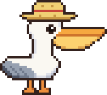</p>
